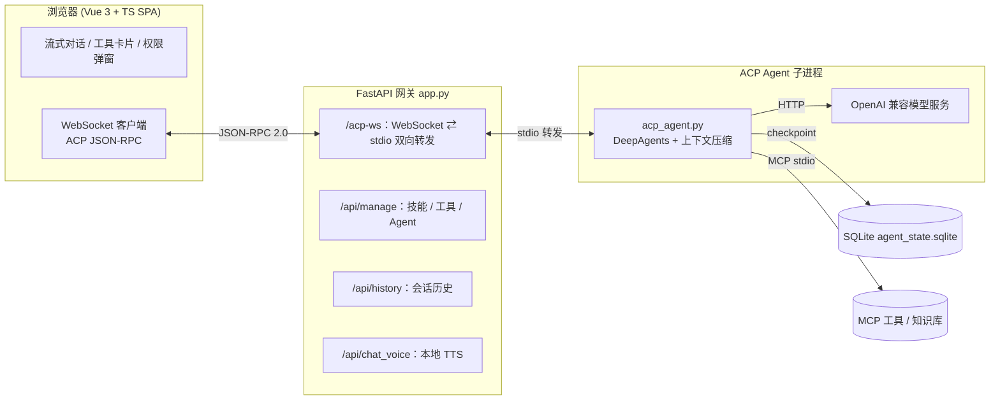

## 从零构建一个可落地的 AI Agent 平台：DeepAgents + ACP + FastAPI 全链路实战

> 关键词：AI Agent、ACP（Agent Client Protocol）、DeepAgents、LangGraph、FastAPI、MCP、流式对话、上下文压缩、RAG、本地语音通话

大模型的能力越来越强，但真正把一个「会聊天的模型」变成一个「能干活的 Agent」，中间隔着一整套工程体系：协议、工具调用、权限控制、上下文管理、持久化、前端渲染……

本文将完整剖析一个**可直接运行**的开源项目 —— 一个基于 **DeepAgents + ACP + FastAPI** 的 Web 版智能体平台。它不是 PPT 里的架构图，而是跑在本地、带前端、带工具、带语音、带定时任务的真实工程。读完本文，你将收获一套把 Agent 工程化落地的完整思路。

---

## 一、这个项目到底解决了什么问题？

市面上很多 Agent Demo 存在几个通病：

1. **协议裸写**：手撸 JSON-RPC、手动解析 `session/update`，耦合严重、难以维护；
2. **工具调用黑盒**：模型调用了什么工具、传了什么参数、返回了什么，前端一无所知；
3. **没有权限控制**：模型想删文件就删文件，想执行命令就执行命令，毫无护栏；
4. **上下文爆炸**：对话一长就超出模型窗口，直接报错中断；
5. **缺乏持久化与多会话**：刷新即丢，无法回溯历史。

本项目围绕这些痛点，给出了一套完整解法：

- 用 **ACP 协议**标准化 Agent 与前端的通信，自动处理进度、计划、工具调用、权限请求；
- 用 **DeepAgents + LangGraph** 承载推理与工具编排，内置 checkpoint 持久化；
- 用 **FastAPI 网关**做 `WebSocket ⇄ stdio` 的纯转发，业务零耦合；
- 用**自研上下文压缩器**在逼近窗口上限前自动「滚动摘要」，对话永不中断；
- 用 **MCP** 动态装配工具，用 **moofile** 做本地持久化，并集成 RAG 知识库与本地语音通话。

---

## 二、整体架构



架构的核心设计原则是**分层解耦**：

| 层 | 文件 | 职责 |
|---|---|---|
| **前端** | `web/`（Vue 3 + TS + Naive UI） | 实现 ACP 客户端，渲染流式消息、工具卡片、权限弹窗 |
| **网关** | `app.py`（FastAPI） | 只做 `WebSocket ⇄ stdio` 转发 + 文件上传，**不解析业务** |
| **Agent** | `acp_agent.py`（DeepAgents） | 推理、工具编排、权限触发、上下文压缩 |
| **模型** | OpenAI 兼容 API | 实际的大模型推理 |

每一个 WebSocket 连接都会拉起一个**独立的 Agent 子进程**，天然实现会话隔离与多会话并行。

---

## 三、关键技术点拆解

### 3.1 用 ACP 协议彻底告别手写 JSON-RPC

**ACP（Agent Client Protocol）** 是一套标准化的 Agent-客户端通信协议，核心是几类 `session/*` 事件：

- `session/update`：任务进度、执行计划、工具调用、流式文本；
- `session/request_permission`：高风险操作（删文件、执行命令）的权限审批；
- `session/request_input`：缺信息时向用户反问。

借助 `deepagents-acp` 和 `agent-client-protocol`，Agent 只需把内部状态暴露出来，协议层会自动映射成标准事件，**完全不用手写 JSON-RPC**。

### 3.2 网关：WebSocket ⇄ stdio 的纯转发

网关的精髓在于「**不懂业务**」。它把前端的 WebSocket 消息原样写进子进程的 stdin，再把子进程 stdout 的 ACP 事件原样推回前端：

```python
@app.websocket("/acp-ws")
async def acp_bridge(websocket: WebSocket):
    await websocket.accept()
    agent_name = websocket.query_params.get("agent", "default") or "default"
    agent_env = os.environ.copy()
    agent_env["AGENT_NAME"] = agent_name  # 前端选的 Agent 通过环境变量注入
    proc = await asyncio.create_subprocess_exec(
        *AGENT_CMD,
        stdin=subprocess.PIPE, stdout=subprocess.PIPE, stderr=subprocess.PIPE,
        cwd=str(BASE_DIR), env=agent_env,
        # ACP 消息可能含 Base64 图片块，远超 asyncio 默认 64 KiB
        limit=16 * 1024 * 1024,
    )

    async def forward_stdout():   # 子进程 stdout(ACP 事件) -> 前端
        while True:
            line = await proc.stdout.readline()
            if not line: break
            text = line.decode("utf-8").strip()
            if text:
                await websocket.send_text(text)

    async def forward_ws():       # 前端(ACP 请求) -> 子进程 stdin
        while True:
            msg = await websocket.receive_text()
            proc.stdin.write((msg + "\n").encode("utf-8"))
            await proc.stdin.drain()
    # ... 任一方向结束即清理整棵进程树，防止 Agent 泄漏
```

工程细节：

1. **缓冲区扩容到 16 MiB**：ACP 消息会携带 Base64 图片，默认 64 KiB 会直接截断；
2. **进程树清理**：Windows 下 venv 的 `python.exe` 是「启动器 + 真实进程」结构，只杀启动器会留下孤儿进程，所以用 `taskkill /T /F` 递归杀掉整棵树。

### 3.3 DeepAgents：工具编排 + 权限护栏 + 持久化

Agent 的构建集中在 `build_agent`，一行 `create_deep_agent` 就把模型、工具、子 Agent、技能、持久化、后端、权限中断全部串起来：

```python
agent = create_deep_agent(
    model=MODEL,
    # 以下工具/技能/子 Agent 配置均由当前 .agent.md YAML 头部解析得到
    tools=[*agent_tools, *configured_todo_tools],
    subagents=agent_subagents or None,
    skills=get_agent_skills(),
    middleware=[
        FilesystemMiddleware(backend=backend, tools=filesystem_tools),
        AgentSkillsMiddleware(
            backend=backend,
            selected_skill_names=get_agent_skill_names(agent_name),
        ),
        _ToolExclusionMiddleware(excluded=excluded_tools),
    ],
    checkpointer=checkpointer,          # AsyncSqliteSaver 持久化到 SQLite
    backend=backend,                    # 组合后端：文件 + Shell + 临时状态
    system_prompt=...,
    interrupt_on={                      # HITL 权限中断
        "execute": False,               # 执行命令（按命令类型记忆"总是允许"）
        "delete": True,                 # 删除文件：强制审批
    },
)
```

**最亮眼的是 `interrupt_on`**：它声明哪些工具在调用前需要人工确认。DeepAgents 会在这些工具执行前抛出 HITL 中断，`deepagents-acp` 把它转成 ACP 的 `session/request_permission`，前端随即弹出「允许 / 拒绝 / 总是允许」。这就是 Agent 的**安全护栏**，防止模型擅自执行破坏性操作。

此外，项目还针对 Windows 做了一个很实在的修复 —— **`PowerShellBackend`**。DeepAgents 默认的 Shell 后端走 `subprocess.run(shell=True)`，在 Windows 上实际调用的是 `cmd.exe`，导致模型写的 PowerShell 语法直接失败。重写后显式调用 `powershell.exe`：

```python
class PowerShellBackend(LocalShellBackend):
    def execute(self, command: str, *, timeout: int | None = None) -> ExecuteResponse:
        result = subprocess.run(
            ["powershell.exe", "-NoLogo", "-NoProfile", "-NonInteractive",
             "-ExecutionPolicy", "Bypass", "-Command", command],
            check=False, shell=False, capture_output=True,
            text=True, timeout=effective_timeout, env=self._env, cwd=str(self.cwd),
        )
        # ... 统一拼装 stdout/stderr/exit code
```

### 3.4 上下文压缩：对话永不「撑爆」

这是整个项目工程含量最高的模块。思路是：**在每次 prompt 之前检查 token 数，逼近窗口上限时自动把早期消息滚动摘要并移除**。

触发逻辑挂在 `AgentServerACP` 的子类里，对业务完全透明：

```python
class CompactingAgentServer(AgentServerACP):
    async def prompt(self, prompt, session_id, message_id=None, **kwargs):
        try:
            agent = self._checkpointed_agent(session_id)
            config = self._session_config(session_id)
            state = await agent.aget_state(config)
            messages = list((state.values or {}).get("messages", []) or [])
            if messages and should_compact(messages):          # 超过 CONTENT_SIZE * 0.8
                await compact_messages(agent, config, messages) # 滚动摘要 + 从 checkpoint 移除
        except Exception:
            logger.exception("[compact] failed; continuing without compaction")  # 压缩失败绝不中断对话
        return await super().prompt(prompt, session_id=session_id, message_id=message_id, **kwargs)
```

压缩器 `utils/context_compactor.py` 做了四项关键优化，避免「越压越傻」：

1. **滚动摘要（Rolling Summary）**：上一轮摘要原文**完整继承**，绝不重写，杜绝逐轮信息衰减；
2. **任务目标锚点（Task Anchor）**：最早的那条用户消息永远**逐字保留**，Agent 不会忘记「最初要干什么」；
3. **结构化摘要模板**：强制模型按「目标 / 已完成 / 当前进度 / 关键事实与绝对路径 / 已做决策 / 待办」分节输出；
4. **分块摘要**：输入过长时按段落切块逐段压缩，取代简单的「掐头去尾」。

token 估算与消息切分的核心：

```python
def estimate_tokens(messages: list[BaseMessage]) -> int:
    """粗略 token 估算（字符数 / 1.7），与前端显示一致。"""
    chars = 0
    for m in messages or []:
        content = getattr(m, "content", "")
        chars += len(content) if isinstance(content, str) else len(str(content))
        for tc in getattr(m, "tool_calls", None) or []:
            chars += len(str(tc.get("args", "")))
    return max(1, round(chars / 1.7))

def split_compact(messages):
    """拆成 (需摘要的早期消息, 需保留的消息)。
    - 旧摘要不删（内容被新摘要继承）；
    - 任务锚点不删；
    - 最近 KEEP_RECENT 条原样保留。
    """
    summaries = [m for m in messages if _is_summary(m)]
    others    = [m for m in messages if not _is_summary(m)]
    anchor    = _task_anchor(others)
    recent    = others[-KEEP_RECENT:]
    early     = [m for m in others[:-KEEP_RECENT] if m is not anchor]
    to_keep   = summaries + ([anchor] if anchor else []) + recent
    return early, to_keep
```

所有阈值都可通过 `.env` 调节：`CONTENT_SIZE`（窗口大小）、`CONTEXT_COMPACT_RATIO`（触发比例，默认 0.8）、`CONTEXT_COMPACT_KEEP_RECENT`（保留最近条数，默认 12）等。

### 3.5 MCP：工具的动态装配

工具不是写死在代码里的，而是通过 **MCP（Model Context Protocol）** 动态装配。配置源是 `.deepagents/agents/agents.json`，每个 Agent 可独立启用不同的技能与 MCP 工具：

```json
{
  "default": {
    "enabled": true,
    "tools": {
      "inner_tools": ["ls", "read_file", "write_file", "edit_file", "glob", "grep", "execute", "task"],
      "mcp_tools": [
        { "server": "calc_server", "tools": [{ "name": "calculate", "...": "..." }] },
        { "server": "spo_server",  "tools": [{ "name": "download_spo_file", "...": "..." }] }
      ]
    },
    "subagents": []
  }
}
```

`utils/mcp_loader.py` 负责把每个 MCP 工具转成 LangChain 的 `StructuredTool`，底层是**按服务共享的 fastmcp stdio Client**，连接惰性创建、进程级复用，关停时统一回收。右侧管理面板的启用/禁用会直接写回 `agents.json`，`build_agent` 下次装配时即刻生效。

### 3.6 其它亮点功能

- **内置 Todo 工具链**：`create_todo / update_todo / get_todo`，让 Agent 先拆任务再执行，状态独立存于 `db/todos/`，不受上下文压缩影响；
- **RAG 知识库**：集成外部 `moofile_base`（独立 `:8888` 服务）做向量检索，通过 `knowledge_server` MCP 的 `retrieve_knowledge` 工具查询；后端不可达时自动跳过工具装配，避免挂起；
- **本地语音通话**：独立语音窗口用浏览器 Web Speech API 做 STT，AI 回复完成后调本地 TTS（genie-tts ONNX / edge-tts / Windows SAPI 三引擎，支持中英日混合分段朗读 + 故障自动降级）；
- **定时任务**：基于 croniter 的 cron / 固定间隔调度，每次运行独立 Agent 会话，无人值守执行；
- **前端富渲染**：Markdown、代码高亮、Mermaid 图、净化后的内联 HTML、工具卡片的 JSON 折叠面板一应俱全。

---

## 四、环境构建与快速上手

### 1）创建虚拟环境并安装依赖

> 要求 Python **3.12.x**

```powershell
python -m venv .venv
.\.venv\Scripts\pip install -r requirements.txt
```

核心依赖一览：

```text
fastapi / uvicorn            # Web 网关
deepagents / deepagents-acp  # Agent 内核 + ACP 协议
langchain-openai / langgraph # 模型接入 + 状态图 + checkpoint
fastmcp                      # MCP stdio 工具客户端
moofile                      # 本地 BSON 持久化（历史 / 附件 / 定时任务）
croniter / aiosqlite         # 定时调度 + 异步 SQLite
genie_tts / edge-tts / pywin32  # 三套 TTS 引擎
```

### 2）配置 `.env`

```env
MODEL_PROVIDER=openai
API_KEY=your-key
ENDPOINT=http://your-openai-compatible-endpoint   # OpenAI 兼容 API 基址
MODEL_NAME=qwen3.8-9b
TEMPERATURE=0.8
MAX_TOKENS=10240

CONTENT_SIZE=32768                 # 上下文窗口（前端显示用量用）
CONTEXT_COMPACT_RATIO=0.80         # 压缩触发比例
```

### 3）启动服务

```powershell
.\.venv\Scripts\python app.py
```

浏览器打开 `http://127.0.0.1:8000/` 即可。网关会自动托管 `web/dist` 构建产物。

> 若需前端开发：进入 `web/` 执行 `npm install && npm run build`。
> Windows 用户还可用 `launcher/` 下的 C# + Photino.NET 桌面启动器（`app.exe`），双击即自动建环境、拉网关、开内嵌 WebView 窗口。

---

## 五、典型应用场景

| 场景 | 本项目如何支撑 |
|---|---|
| **企业内部智能助手** | OpenAI 兼容接入私有化模型 + MCP 对接内部系统（如示例中的 SharePoint）+ 权限护栏保障安全 |
| **自动化运维 / 脚本执行** | PowerShell 后端 + `execute` 工具 + 删除操作强制审批 |
| **长文档 / 长任务处理** | 上下文压缩确保超长对话不中断，任务锚点保证目标不丢失 |
| **知识库问答（RAG）** | 集成 moofile_base 向量检索，Agent 自主调用 `retrieve_knowledge` |
| **无人值守定时任务** | cron / 间隔调度，每次独立会话运行 |
| **语音交互 / 无障碍** | 本地 STT + TTS 闭环，支持中英日混合 |

---

## 六、同类可替代方案对比

| 方案 | 特点 | 与本项目的差异 |
|---|---|---|
| **原生 OpenAI Assistants API** | 云端托管、开箱即用 | 工具/数据强绑定云端，难以私有化、难以精细控权 |
| **LangChain AgentExecutor** | 生态成熟、工具丰富 | 缺标准化前端协议与权限 HITL，需自行封装流式与 UI |
| **AutoGPT / BabyAGI 系** | 自主循环执行 | 偏实验性，缺持久化、权限、上下文治理等工程化能力 |
| **Dify / Coze 等低代码平台** | 可视化编排、上手快 | 灵活性受限于平台能力，深度定制（如自定义 Backend、压缩策略）困难 |
| **本项目** | ACP 标准协议 + DeepAgents 内核 + 全栈可控 | **完全自托管、可深度定制、带权限/压缩/持久化/语音的工程化闭环** |

一句话：**如果你需要一个能私有化部署、可深度定制、具备工程化护栏的 Agent 平台，而不是一个云端黑盒，本项目是极佳的起点。**

---

## 七、总结

这个项目的价值不在于某一个炫技功能，而在于它把「让 Agent 真正干活」所需的工程要素**系统性地补齐了**：

- **协议标准化**（ACP）让通信不再是手工活；
- **分层解耦**（网关纯转发）让各层可独立演进；
- **权限护栏**（`interrupt_on` → HITL）让 Agent 安全可控；
- **上下文治理**（滚动摘要 + 任务锚点）让长对话稳如磐石；
- **动态工具装配**（MCP + agents.json）让能力可插拔；
- **本地持久化 + 多会话 + 语音 + 定时任务**让它真正可用。

希望这篇拆解能帮你在构建自己的 Agent 系统时少走弯路。如果你也在做 Agent 工程化，欢迎留言交流～ 🚀

> 项目技术栈：`DeepAgents` · `ACP` · `LangGraph` · `FastAPI` · `Vue 3` · `MCP` · `moofile`
> 运行环境：Python 3.12 + Windows / OpenAI 兼容模型服务
